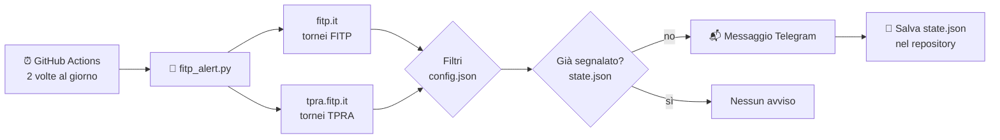

<div align="center">

# 🎾 Avvisi Tornei FITP e TPRA

**Ricevi su Telegram i nuovi tornei di tennis della tua provincia, appena aprono le iscrizioni.**

Gratis. Senza server. Senza app da installare.

[](https://github.com/fedeveloper/puc/actions/workflows/check.yml)
[](LICENSE)
[](https://github.com/fedeveloper/puc/commits/main)

[](https://www.python.org/)
[](https://docs.github.com/actions)
[](https://core.telegram.org/bots/api)
[](#-requisiti)
[](#-come-funziona)

[Funzionalità](#-funzionalità) ·
[Come funziona](#-come-funziona) ·
[Installazione](#-installazione) ·
[Configurazione](#%EF%B8%8F-configurazione) ·
[Utilizzo](#-utilizzo) ·
[Domande frequenti](#-domande-frequenti)

</div>

---

## 🎯 Perché esiste

Chi gioca a tennis a livello amatoriale conosce il problema. I tornei aprono le iscrizioni in momenti diversi. I posti finiscono in fretta. Per non perderli devi controllare ogni giorno il sito della FITP e quello del TPRA.

Questo progetto fa il controllo al posto tuo. Due volte al giorno cerca i tornei della tua zona. Quando trova un torneo nuovo con le iscrizioni aperte, ti manda un messaggio su Telegram.

Tu leggi il messaggio, tocchi il link e ti iscrivi.

> **NOTA:** Il progetto non ha legami con la Federazione Italiana Tennis e Padel (FITP). Il progetto legge solo i dati pubblici dei siti [fitp.it](https://www.fitp.it/Tornei/Ricerca-tornei) e [tpra.fitp.it](https://tpra.fitp.it).

## ✨ Funzionalità

| | |
|---|---|
| 🔎 **Due fonti** | Cerca i tornei federali su fitp.it e i tornei amatoriali TPRA su tpra.fitp.it. Puoi attivare una sola fonte o tutte e due. |
| 📍 **Filtro per zona** | Cerca solo nella regione e nella provincia che scegli. |
| 🎾 **Filtro per tipo** | Scegli singolare o doppio, maschile o femminile. Puoi escludere i tornei giovanili (Under). |
| 📊 **Filtro per livello TPRA** | Scegli il livello (Entry, Expert, Power) e la fascia di classifica power. |
| ⏰ **Solo iscrizioni aperte** | Segnala solo i tabelloni con la scadenza futura. Per il TPRA controlla anche i posti liberi. |
| 🔁 **Nessun doppione** | Ricorda i tornei già segnalati. Ogni torneo arriva una sola volta. |
| 📬 **Un solo messaggio** | Raggruppa tutti i tornei nuovi in un unico messaggio Telegram. |
| 💸 **Gratis** | Usa GitHub Actions e un bot Telegram. Non serve un server. Non serve una carta di credito. |
| 🪶 **Leggero** | Un solo file Python. Usa solo la libreria standard: non devi installare pacchetti. |

### Un esempio di messaggio

```text
Nuovi tornei con iscrizioni aperte: 2

🎾 Torneo di Natale – Circolo Tennis Esempio
Singolare Maschile Open LIM. 4.3 - 4.1
📍 Circolo Tennis Esempio – Torino
📅 06/12/2026 → 20/12/2026
⏰ Iscrizioni entro 03/12/2026 13:00
🏅 Classifiche: 4.NC - 4.1
🏟 Terra rossa
Apri su fitp.it

🎾 TPRA – Coppa d'Inverno
Singolare Maschile · Limit 45 · Circuito Esempio
📍 Tennis Club Esempio – Torino (TO)
📅 13/12/2026
⏰ Iscrizioni entro 10/12/2026 18:00
👥 Iscritti 5/16
💶 20 €
Apri su tpra.fitp.it
```

> **NOTA:** I nomi e le date in questo esempio sono di fantasia.

## 🧠 Come funziona



1. GitHub Actions avvia lo script due volte al giorno.
2. Lo script chiede a fitp.it le competizioni della tua provincia che iniziano da oggi in poi.
3. Per ogni competizione, lo script legge i tabelloni e tiene quelli che corrispondono ai tuoi filtri.
4. Lo script chiede a tpra.fitp.it i tornei TPRA della stessa provincia e dello stesso tipo.
5. Lo script scarta i tornei con la scadenza passata, i tornei TPRA senza posti liberi e i tornei già segnalati.
6. Lo script manda un messaggio Telegram con i tornei rimasti.
7. Lo script scrive i tornei segnalati nel file `state.json`. GitHub Actions salva il file nel repository.

Lo script cancella da `state.json` i tornei con la scadenza passata da più di 60 giorni. Così il file resta piccolo.

## 📦 Requisiti

- Un account [GitHub](https://github.com) gratuito.
- Un account [Telegram](https://telegram.org).
- Solo per le prove sul tuo computer: Python 3.9 o una versione più recente.

Non devi installare librerie esterne.

## 🚀 Installazione

L'installazione richiede circa 10 minuti. Non devi scrivere codice.

### 1. Copia il repository

1. Apri la pagina [fedeveloper/puc](https://github.com/fedeveloper/puc).
2. Fai clic su **Fork** in alto a destra.
3. Fai clic su **Create fork**.

> **NOTA:** Un fork di un repository pubblico è pubblico. Il file `state.json` mostra i tornei segnalati, ma non contiene dati personali. Per una copia privata usa [GitHub Importer](https://github.com/new/import) al posto del fork.

### 2. Azzera i tornei già segnalati

Il file `state.json` contiene i tornei già segnalati all'autore del progetto. Se non lo azzeri, non ricevi quei tornei.

1. Nel tuo fork, apri il file `state.json`.
2. Fai clic sull'icona della matita (**Edit this file**).
3. Sostituisci tutto il contenuto con questo testo:

   ```json
   {"seen": {}}
   ```

4. Fai clic su **Commit changes**.

### 3. Crea il bot Telegram

1. Su Telegram, apri la chat con [@BotFather](https://t.me/BotFather).
2. Scrivi il comando `/newbot`.
3. Scrivi un nome per il bot, per esempio `Avvisi Tornei`.
4. Scrivi un nome utente che finisce con `bot`, per esempio `avvisi_tornei_mario_bot`.
5. Copia il **token** che BotFather ti manda. Il token ha questa forma: `123456789:ABCdefGhIJKlmNoPQRstuVWXyz`.

> **ATTENZIONE:** Il token è come una password. Non scriverlo mai nel codice e non condividerlo.

### 4. Trova il tuo chat id

Il chat id è il numero che identifica la tua chat con il bot.

1. Apri la chat con il tuo nuovo bot.
2. Fai clic su **Avvia** (o scrivi `/start`).
3. Scrivi un messaggio qualsiasi, per esempio `ciao`.
4. Nel browser, apri questo indirizzo. Sostituisci `<TOKEN>` con il tuo token:

   ```text
   https://api.telegram.org/bot<TOKEN>/getUpdates
   ```

5. Cerca il testo `"chat":{"id":` e copia il numero che segue. Per esempio: `123456789`.

> **NOTA:** Se la pagina mostra `"result":[]`, scrivi un altro messaggio al bot e ricarica la pagina.

### 5. Salva token e chat id nei GitHub Secrets

I *GitHub Secrets* sono valori cifrati. Solo il workflow li può leggere.

1. Nel tuo fork, apri **Settings**.
2. Nel menu a sinistra, apri **Secrets and variables → Actions**.
3. Fai clic su **New repository secret**.
4. In **Name** scrivi `TELEGRAM_BOT_TOKEN`. In **Secret** incolla il token.
5. Fai clic su **Add secret**.
6. Fai clic di nuovo su **New repository secret**.
7. In **Name** scrivi `TELEGRAM_CHAT_ID`. In **Secret** incolla il chat id.
8. Fai clic su **Add secret**.

### 6. Scegli la tua zona e i tuoi filtri

1. Nel tuo fork, apri il file `config.json`.
2. Fai clic sull'icona della matita.
3. Cambia i valori. La sezione [Configurazione](#%EF%B8%8F-configurazione) spiega ogni campo.
4. Fai clic su **Commit changes**.

### 7. Attiva GitHub Actions

GitHub disattiva i workflow nei fork appena creati.

1. Nel tuo fork, apri la scheda **Actions**.
2. Fai clic su **I understand my workflows, go ahead and enable them**.
3. Nel menu a sinistra, fai clic su **Controlla tornei FITP e TPRA**.
4. Se GitHub mostra un avviso sui workflow programmati, fai clic su **Enable workflow**.

### 8. Fai la prima prova

1. Nella scheda **Actions**, apri **Controlla tornei FITP e TPRA**.
2. Fai clic su **Run workflow**, poi di nuovo su **Run workflow**.
3. Aspetta uno o due minuti.
4. Controlla Telegram.

Il primo controllo manda **tutti** i tornei già aperti. I controlli successivi mandano solo i tornei nuovi.

🎉 Fatto. Da adesso il controllo parte da solo due volte al giorno.

## ⚙️ Configurazione

Il file `config.json` contiene tutte le impostazioni. Questo è il file predefinito:

```json
{
  "id_regione": 1,
  "id_provincia": 201,
  "gender": "M",
  "doubles": false,
  "age_category": "NOR",
  "fitp": {
    "enabled": true
  },
  "tpra": {
    "enabled": true,
    "id_settore_gruppo": null,
    "id_power_range": null
  }
}
```

Questa configurazione cerca i tornei di singolare maschile, categoria assoluta, in provincia di Torino.

### Campi

| Campo | Valori | Significato |
|---|---|---|
| `id_regione` | numero | Codice della regione. Vedi la [tabella dei codici](#-codici-di-regioni-e-province). |
| `id_provincia` | numero | Codice della provincia. Vedi la [tabella dei codici](#-codici-di-regioni-e-province). |
| `gender` | `"M"` o `"F"` | `"M"` per i tornei maschili, `"F"` per i tornei femminili. |
| `doubles` | `false` o `true` | `false` per i singolari, `true` per i doppi. |
| `age_category` | `"NOR"` o `null` | `"NOR"` tiene solo la categoria assoluta ed esclude i tornei Under. `null` tiene tutte le categorie. Vale solo per i tornei FITP. |
| `fitp.enabled` | `true` o `false` | `false` disattiva la ricerca su fitp.it. Se il campo manca, vale `true`. |
| `tpra.enabled` | `true` o `false` | `false` disattiva la ricerca su tpra.fitp.it. Se il campo manca, vale `true`. |
| `tpra.id_settore_gruppo` | numero o `null` | Livello TPRA. Vedi la tabella sotto. `null` tiene tutti i livelli. |
| `tpra.id_power_range` | numero o `null` | Fascia power TPRA. Vedi la tabella sotto. `null` tiene tutte le fasce. |

Il campo `_note` contiene solo un promemoria. Lo script non lo legge.

### Livelli TPRA (`tpra.id_settore_gruppo`)

| Codice | Livello |
|---|---|
| `9` | Entry Level |
| `10` | Expert Level |
| `11` | Power personalizzati |
| `null` | Tutti i livelli |

### Fasce power TPRA (`tpra.id_power_range`)

| Codice | Fascia | Codice | Fascia |
|---|---|---|---|
| `1` | Limit 30 | `6` | Limit 55 |
| `2` | Limit 35 | `7` | Limit 60 |
| `3` | Limit 40 | `8` | Limit 65 |
| `4` | Limit 45 | `9` | Limit 70 |
| `5` | Limit 50 | `10` | Open |
| | | `null` | Tutte le fasce |

### Esempi

<details>
<summary><b>Doppio femminile a Milano, solo TPRA</b></summary>

```json
{
  "id_regione": 3,
  "id_provincia": 215,
  "gender": "F",
  "doubles": true,
  "age_category": "NOR",
  "fitp": { "enabled": false },
  "tpra": { "enabled": true, "id_settore_gruppo": null, "id_power_range": null }
}
```

</details>

<details>
<summary><b>Singolare maschile a Roma, TPRA solo Limit 45</b></summary>

```json
{
  "id_regione": 12,
  "id_provincia": 258,
  "gender": "M",
  "doubles": false,
  "age_category": "NOR",
  "fitp": { "enabled": true },
  "tpra": { "enabled": true, "id_settore_gruppo": null, "id_power_range": 4 }
}
```

</details>

### 🗺 Codici di regioni e province

Questi codici valgono sia per fitp.it sia per tpra.fitp.it.

<details>
<summary><b>Mostra la tabella completa</b></summary>

| Regione | `id_regione` | Province (`id_provincia`) |
|---|---|---|
| Abruzzo | `13` | Chieti `69`, L'Aquila `66`, Pescara `68`, Teramo `67` |
| Basilicata | `17` | Matera `77`, Potenza `76` |
| Calabria | `18` | Catanzaro `79`, Cosenza `78`, Crotone `101`, Reggio Calabria `280`, Vibo Valentia `102` |
| Campania | `15` | Avellino `64`, Benevento `62`, Caserta `61`, Napoli `263`, Salerno `65` |
| Emilia-Romagna | `8` | Bologna `237`, Ferrara `38`, Forlì-Cesena `40`, Modena `36`, Parma `34`, Piacenza `33`, Ravenna `39`, Reggio nell'Emilia `35`, Rimini `99` |
| Friuli-Venezia Giulia | `6` | Gorizia `31`, Pordenone `93`, Trieste `32`, Udine `30` |
| Lazio | `12` | Frosinone `60`, Latina `59`, Rieti `57`, Roma `258`, Viterbo `56` |
| Liguria | `7` | Genova `210`, Imperia `8`, La Spezia `11`, Savona `9` |
| Lombardia | `3` | Bergamo `16`, Brescia `17`, Como `13`, Cremona `19`, Lecco `97`, Lodi `98`, Mantova `20`, Milano `215`, Monza e della Brianza `108`, Pavia `18`, Sondrio `14`, Varese `12` |
| Marche | `11` | Ancona `42`, Ascoli Piceno `44`, Fermo `109`, Macerata `43`, Pesaro e Urbino `41` |
| Molise | `14` | Campobasso `70`, Isernia `94` |
| Piemonte | `1` | Alessandria `6`, Asti `5`, Biella `96`, Cuneo `4`, Novara `3`, Torino `201`, Verbano-Cusio-Ossola `103`, Vercelli `2` |
| Puglia | `16` | Bari `272`, Barletta-Andria-Trani `110`, Brindisi `74`, Foggia `71`, Lecce `75`, Taranto `73` |
| Sardegna | `20` | Cagliari `292`, Nuoro `91`, Oristano `95`, Sassari `90`, Sud Sardegna `111` |
| Sicilia | `19` | Agrigento `84`, Caltanissetta `85`, Catania `287`, Enna `86`, Messina `283`, Palermo `282`, Ragusa `88`, Siracusa `89`, Trapani `81` |
| Toscana | `9` | Arezzo `51`, Firenze `248`, Grosseto `53`, Livorno `49`, Lucca `46`, Massa-Carrara `45`, Pisa `50`, Pistoia `47`, Prato `100`, Siena `52` |
| Trentino-Alto Adige | `4` | Bolzano `21`, Trento `22` |
| Umbria | `10` | Perugia `54`, Terni `55` |
| Valle d'Aosta | `2` | Aosta `7` |
| Veneto | `5` | Belluno `25`, Padova `28`, Rovigo `29`, Treviso `26`, Venezia `227`, Verona `23`, Vicenza `24` |

</details>

## 🕹 Utilizzo

Dopo l'installazione non devi fare niente. Il controllo parte da solo e i messaggi arrivano su Telegram.

### Avvia un controllo subito

1. Apri la scheda **Actions** del tuo repository.
2. Fai clic su **Controlla tornei FITP e TPRA**.
3. Fai clic su **Run workflow**.

### Cambia gli orari dei controlli

Il file `.github/workflows/check.yml` contiene gli orari. GitHub usa l'ora UTC.

```yaml
on:
  schedule:
    - cron: "0 7 * * *"   # 08:00 in inverno, 09:00 in estate (ora italiana)
    - cron: "0 18 * * *"  # 19:00 in inverno, 20:00 in estate (ora italiana)
```

Per aggiungere un controllo alle 13:00 italiane d'inverno, aggiungi la riga `- cron: "0 12 * * *"`.

> **NOTA:** GitHub non garantisce l'orario esatto. Nei momenti di traffico alto, un controllo può partire anche con qualche ora di ritardo.

### Metti in pausa gli avvisi

1. Apri la scheda **Actions**.
2. Fai clic su **Controlla tornei FITP e TPRA**.
3. Fai clic sul menu **···** in alto a destra.
4. Fai clic su **Disable workflow**.

Per riattivare gli avvisi, ripeti i passi e fai clic su **Enable workflow**.

### Prova lo script sul tuo computer

Il comando `--dry-run` stampa i messaggi a schermo. Non manda niente su Telegram e non modifica `state.json`.

```bash
git clone https://github.com/<tuo-utente>/puc.git
cd puc
python3 fitp_alert.py --dry-run
```

Opzioni disponibili:

| Opzione | Significato |
|---|---|
| `--dry-run` | Stampa i messaggi invece di inviarli. Non salva lo stato. |
| `--config FILE` | Usa un file di configurazione diverso da `config.json`. |
| `--state FILE` | Usa un file di stato diverso da `state.json`. |

Per inviare davvero i messaggi dal tuo computer, imposta le variabili `TELEGRAM_BOT_TOKEN` e `TELEGRAM_CHAT_ID` prima di avviare lo script.

## ❓ Domande frequenti

<details>
<summary><b>Non ricevo nessun messaggio. Cosa controllo?</b></summary>

1. Apri la scheda **Actions** e controlla che l'ultimo controllo abbia l'icona verde.
2. Se l'icona è rossa, apri il controllo e leggi l'errore.
3. Controlla i nomi dei due secrets: `TELEGRAM_BOT_TOKEN` e `TELEGRAM_CHAT_ID`.
4. Controlla di avere scritto almeno un messaggio al bot.

Se l'icona è verde e il registro dice `Nuovi tornei segnalati: 0`, lo script funziona. Non ci sono tornei nuovi.

</details>

<details>
<summary><b>Il controllo delle 8 non è arrivato. È un errore?</b></summary>

Di solito no. GitHub avvia i workflow programmati quando ha risorse libere. A volte il ritardo è di qualche ora. Apri la scheda **Actions** per vedere quando è partito l'ultimo controllo.

</details>

<details>
<summary><b>Voglio ricevere di nuovo tutti i tornei aperti.</b></summary>

Sostituisci il contenuto di `state.json` con `{"seen": {}}`. Il controllo successivo manda tutti i tornei aperti.

</details>

<details>
<summary><b>Posso mandare gli avvisi a un gruppo Telegram?</b></summary>

Sì. Aggiungi il bot al gruppo e scrivi un messaggio nel gruppo. Poi apri l'indirizzo `getUpdates` come nel passo 4. Il chat id di un gruppo inizia con il segno meno, per esempio `-1001234567890`. Usa questo numero in `TELEGRAM_CHAT_ID`.

</details>

<details>
<summary><b>Il servizio costa qualcosa?</b></summary>

No. Telegram è gratuito. GitHub Actions è gratuito per i repository pubblici. Per i repository privati il piano gratuito include 2000 minuti al mese. Un controllo dura circa un minuto, quindi bastano circa 60 minuti al mese.

</details>

<details>
<summary><b>GitHub ha disattivato il workflow. Perché?</b></summary>

GitHub disattiva i workflow programmati dopo 60 giorni senza attività nel repository. Lo script salva `state.json` a ogni torneo nuovo, quindi di solito il repository resta attivo. Se GitHub disattiva il workflow, apri la scheda **Actions** e fai clic su **Enable workflow**.

</details>

## 🔒 Sicurezza

- Il token e il chat id stanno solo nei *GitHub Secrets*. GitHub li cifra e li nasconde con `***` nei registri.
- Il token e il chat id non entrano mai nel codice né in `state.json`.
- Lo script non stampa mai l'indirizzo di Telegram, perché l'indirizzo contiene il token. Questo vale anche in caso di errore.
- Il workflow ha un solo permesso: scrivere nel repository, per salvare `state.json`.
- Con il token, una persona può solo mandare messaggi a nome del tuo bot. Se perdi il token, scrivi `/revoke` a [@BotFather](https://t.me/BotFather) e crea un token nuovo.

## 🗂 Struttura del progetto

```text
.
├── .github/workflows/check.yml   # Orari e passi del controllo automatico
├── fitp_alert.py                 # Lo script: cerca, filtra e invia
├── config.json                   # Le tue impostazioni
├── state.json                    # I tornei già segnalati (aggiornato in automatico)
├── LICENSE                       # Licenza MIT
└── README.md                     # Questa pagina
```

## 🤝 Contribuire

I contributi sono benvenuti.

1. Apri una [issue](https://github.com/fedeveloper/puc/issues) per segnalare un problema o proporre un'idea.
2. Per una modifica al codice, fai un fork e apri una pull request.
3. Prima della pull request, prova lo script con `python3 fitp_alert.py --dry-run`.

## 📄 Licenza

Il progetto usa la licenza [MIT](LICENSE). Puoi usare, copiare e modificare il codice. Devi solo mantenere l'avviso di copyright.

---

<div align="center">

Fatto con 🎾 e ☕.

Se il progetto ti è utile, lascia una ⭐ al repository.

</div>
